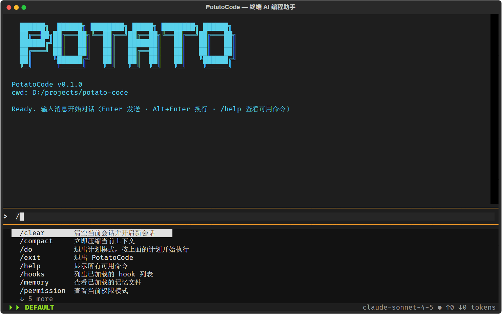

# PotatoCode

**用 Python 从零实现的终端 AI 编程助手** —— 在终端里对话、读写代码、执行命令、审查变更。独立实现，交互与架构参考 Claude Code。




> 启动界面：banner、输入区、斜杠命令补全与权限模式状态栏。

## 核心能力

- **完整 Agent 运行时**：ReAct 循环、工具调用保序分批（只读并发 / 副作用串行）、取消与异常路径的历史合法性兜底，避免下一轮请求因 tool_call/tool_result 不配对而失败。
- **五层权限护栏**：黑名单 → 路径沙箱 → 三级规则文件 → 模式矩阵 → 人在回路；规则支持精确、正则、反向、glob 四种匹配。
- **长会话不崩**：两层上下文压缩（大结果落盘 + LLM 摘要）、真实 usage 锚点估算、摘要熔断与紧急压缩。
- **可插拔扩展面**：MCP 工具、Skill 能力包、11 个生命周期 Hook、SubAgent 主从任务分发。
- **可验证的工程质量**：约 1.4 万行源码、58 个测试文件，覆盖 Agent Loop、权限、压缩、Hook、Skill、SubAgent；配套 ruff / mypy 检查命令；ch02–ch15 共 14 章设计文档全部在 `docs/`。

## 快速开始

### 环境要求

- Python 3.12+
- [uv](https://github.com/astral-sh/uv)（推荐）或 pip
- Windows / macOS / Linux

### 安装

```bash
git clone https://gitee.com/potato-man-121/potato-code.git
cd potato-code
uv sync

# 也可以使用 pip
pip install -e .
```

### 配置

复制配置模板，填入真实密钥：

```bash
cp .potatocode/config.yaml.example .potatocode/config.yaml
```

最小配置如下。`config.yaml` 已被 `.gitignore` 忽略，请勿把真实密钥提交到仓库。

```yaml
providers:
  - name: Claude
    protocol: anthropic
    api_key: sk-ant-xxx
    model: claude-sonnet-4-5
    thinking: true
    context_window: 200000

  # 任意 OpenAI 兼容端点
  - name: DeepSeek
    protocol: openai
    api_key: sk-xxx
    model: deepseek-chat
    base_url: https://api.deepseek.com/v1
```

配置了多个 provider 时，启动后会先进入选择界面；只有一个时直接进入对话。

### 运行

```bash
uv run potatocode
# 或（已 pip install -e .）
python -m potatocode
```

### 验证

```bash
uv run pytest
```

## 使用示例

```text
    ██████╗  ██████╗ ████████╗ █████╗ ████████╗ ██████╗
    ██╔══██╗██╔═══██╗╚══██╔══╝██╔══██╗╚══██╔══╝██╔═══██╗
    ██████╔╝██║   ██║   ██║   ███████║   ██║   ██║   ██║
    ██╔═══╝ ██║   ██║   ██║   ██╔══██║   ██║   ██║   ██║
    ██║     ╚██████╔╝   ██║   ██║  ██║   ██║   ╚██████╔╝
    ╚═╝      ╚═════╝    ╚═╝   ╚═╝  ╚═╝   ╚═╝    ╚═════╝

  PotatoCode v0.1.0
  cwd: /path/to/your/project

  Ready. 输入消息开始对话（Enter 发送 · Alt+Enter 换行 · 输入 /help 查看可用命令）

> 看看 agent 循环的停止条件，并补一个测试

● 我先定位停止条件的实现，再补测试。
● read_file(src/potatocode/agent/__init__.py)
  ⎿ 已读取 500+ 行
● grep("MAX_ITERATIONS|MAX_UNKNOWN_RUN")
  ⎿ 2 处匹配
● write_file(tests/test_agent_stop.py)
  ⎿ 已写入 42 行
● 停止条件包括自然完成、迭代上限、用户取消和连续未知工具；
  新测试覆盖了后两条路径。
  ⏱ 6.4s

⏵⏵ DEFAULT                         claude-sonnet-4-5 ● ↑12.4k ↓1.8k tokens
```

**常用键位**：`Enter` 发送 · `Alt+Enter` 换行 · `Shift+Tab` 切换权限模式 · `Ctrl+C` 取消本轮 / 空闲时退出 · `Esc` 取消。

## 斜杠命令

| 命令 | 作用 |
|---|---|
| `/help` | 显示所有可用命令 |
| `/status` | 查看当前状态概览 |
| `/session` | 查看当前会话信息 |
| `/resume` | 恢复历史会话 |
| `/clear` | 清空当前会话并开启新会话 |
| `/compact` | 立即压缩当前上下文 |
| `/plan` | 切换到计划模式（仅只读工具） |
| `/do` | 退出计划模式，按计划开始执行 |
| `/permission` | 查看当前权限模式 |
| `/memory` | 查看已加载的记忆文件 |
| `/hooks` | 列出已加载的 Hook |
| `/review` | 请求 AI 审查当前代码变更 |
| `/exit` | 退出 PotatoCode |

另提供 `/skill` 管理命令（`list` / `info` / `reload`），以及每个 Skill 自动生成的同名斜杠命令。

## 功能一览

| 模块 | 已实现 |
|---|---|
| 模型接入 | Anthropic / OpenAI 双协议、流式输出、自定义 `base_url`、扩展思考 |
| 工具系统 | `read_file` / `write_file` / `edit_file` / `bash` / `glob` / `grep`，超时与结构化错误回灌 |
| 权限 | 五层短路、4 种模式（default / acceptEdits / plan / bypassPermissions）、三级规则、人在回路三选 |
| 上下文 | 两层压缩、三种触发（自动 / 手动 / 紧急）、熔断保护、超长工具结果落盘 |
| 扩展 | MCP（stdio / HTTP 双传输）、Skill（inline / fork）、Hook（11 事件 / 4 类动作，subagent 占位）、SubAgent（定义式 / Fork / 后台） |
| 会话 | JSONL 实时存档、`/resume`、30 天过期清理、自动记忆、`POTATOCODE.md` 项目指令 |
| 界面 | Textual TUI、Markdown 渲染、斜杠补全、双通道输出、后台任务通知 |

## 配置说明

| 文件 | 用途 |
|---|---|
| `.potatocode/config.yaml` | provider、模型、上下文窗口；模板见 `config.yaml.example` |
| `.potatocode/settings.yaml`<br>`.potatocode/settings.local.yaml`<br>`~/.potatocode/settings.yaml` | 权限规则，三级合并；「永久允许」自动写入本地级 |
| `.potatocode/hooks.yaml`<br>`~/.potatocode/hooks.yaml` | 生命周期 Hook，两层叠加 |
| `.potatocode/mcp_servers.yaml`<br>`~/.potatocode/mcp_servers.yaml` | MCP server；`${VAR}` 从环境变量展开 |
| `POTATOCODE.md`<br>`.potatocode/POTATOCODE.md`<br>`~/.potatocode/POTATOCODE.md` | 项目指令，三层合并，支持 `@include` 嵌套 |
| `.potatocode/skills/`<br>`.potatocode/agents/`<br>`.potatocode/memory/` | 项目级 Skill、SubAgent 角色与长期记忆 |

权限规则示例：

```yaml
default_mode: default

permissions:
  allow:
    - "Bash(~^git )"      # 正则：放行 git 子命令
    - "Bash(=pytest)"     # 精确：放行 pytest
  deny:
    - "Bash(rm *)"        # glob：拦截 rm 系列
    - "Read(.env)"        # 拦截读取 .env
```

## 架构设计

```text
┌──────────────────────────────────────────────────────────────┐
│ tui          Textual App · 状态机 · 事件流消费 · 命令桥接     │
├──────────────────────────────────────────────────────────────┤
│ 扩展面        command · skills · hook · subagent · task       │
├──────────────────────────────────────────────────────────────┤
│ agent        ReAct Loop · run_to_completion · AgentTool       │
├──────────────────────────────────────────────────────────────┤
│ 核心子系统    tool · permission · compact                     │
│              instructions · session · memory                  │
├──────────────────────────────────────────────────────────────┤
│ 基础层        conversation · prompt · llm(Protocol) · mcp     │
└──────────────────────────────────────────────────────────────┘
```

三条贯穿全局的设计原则：

- **历史合法性**：任何停止路径（自然完成 / 达上限 / 取消 / 出错）都会补齐 `tool_call` / `tool_result` 配对与角色交替。
- **缓存前缀稳定**：系统提示模块化排序、压缩替换决策冻结、环境段与 reminder 走独立通道，尽量复用 prompt cache。
- **降级不打断**：工具、压缩、记忆、Hook、会话恢复的失败都转为结构化错误回灌或跳过，不终止主对话。

完整分层图、一次对话的数据流、11 个 Hook 事件与各子系统细节见 [`docs/architecture.md`](docs/architecture.md)。

## 扩展能力

### Skill：可复用的 SOP 能力包

在 `.potatocode/skills/<name>/SKILL.md` 放置带 YAML frontmatter 的 Markdown，系统提示只注入 `name + description`，完整 SOP 按需经消息通道加载。支持 `inline`（注入当前对话）与 `fork`（后台子 Agent 隔离执行）两种模式；`InstallSkill` 工具可从 URL 安装 Skill。

### Hook：生命周期自动化

在 `.potatocode/hooks.yaml` 声明「事件 + 条件 + 动作」，覆盖 `SessionStart`、`UserPromptSubmit`、`PreToolUse`、`PostToolUse`、`Stop` 等 11 个时刻。动作支持 `shell`、`prompt`、`http`、`subagent`（占位），可拦截工具调用或向下一轮注入提醒。

### SubAgent：主从任务分发

主 Agent 通过 `Agent` 工具把独立子任务交给子 Agent，支持定义式（角色文件）与 Fork 式（继承父对话）；前台超时自动转后台，完成后以 `<task-notification>` 回流。内置 `general-purpose`、`Explore`、`Plan` 三个角色，也可在 `.potatocode/agents/` 自定义。

### MCP：接入外部工具生态

MCP 工具以 `mcp__<server>__<tool>` 命名注册进同一工具注册中心，对 Agent 透明，并自动继承权限护栏。

```yaml
# .potatocode/mcp_servers.yaml
mcp_servers:
  context7:
    type: stdio
    command: npx
    args: ["-y", "@upstash/context7-mcp"]
    env:
      CONTEXT7_API_KEY: "${CONTEXT7_API_KEY}"
```

## 项目结构

```text
src/potatocode/
├── agent/         # ReAct 循环、SessionRuntime、子 Agent 分发
├── tool/          # 工具协议、注册中心、6 个内置工具
├── permission/    # 五层权限引擎与四式匹配器
├── compact/       # 两层上下文压缩
├── llm/           # Provider Protocol 与 Anthropic / OpenAI 适配
├── mcp/           # MCP 客户端
├── skills/        # SOP 能力包
├── hook/          # 生命周期 Hook
├── subagent/      # Agent 角色定义与三层目录
├── task/          # 后台任务管理
├── command/       # 斜杠命令注册中心
├── prompt/        # 系统提示装配与缓存通道
├── session/       # JSONL 会话存档
├── memory/        # 自动记忆
├── instructions/  # POTATOCODE.md 三层加载
├── tui/           # Textual 界面
└── cli.py         # 组装根
tests/             # 58 个测试文件
docs/              # ch02–ch15 设计文档 + architecture.md
```

## 开发与测试

```bash
uv run ruff format --check .
uv run ruff check .
uv run pytest
uv run mypy src/potatocode
```

项目采用 spec 驱动开发：每章在 `docs/chXX/` 下依次产出 `spec.md` → `plan.md` → `task.md` → `checklist.md`，完成后对照 checklist 验收。架构总览与 14 章能力演进见 [`docs/architecture.md`](docs/architecture.md)。

## 设计取舍与已知边界

- 当前版本 `0.1.0`，面向学习与工程实践，未做生产级压测。
- 模型别名切换接口已预留，`Agent` 工具暂沿用父 provider。
- 后台任务不跨会话持久化；前台子 Agent 仅在超时后自动转后台，暂不支持 ESC 手动切换。
- Hook 的 `subagent` 动作目前为占位实现。

## 贡献

欢迎提交 Issue 和 Pull Request。提交前请确保 `pytest` 通过，并尽量保持 `ruff` 检查干净；较大改动建议先在 Issue 中说明设计思路。

## License

[Apache-2.0](LICENSE) © 2026 Potato Man

## 致谢

交互与架构参考 [Claude Code](https://claude.com/claude-code)；界面基于 [Textual](https://textual.textualize.io/) 与 [Rich](https://rich.readthedocs.io/)；协议适配使用 [Anthropic SDK](https://github.com/anthropics/anthropic-sdk-python) 与 [OpenAI SDK](https://github.com/openai/openai-python)；工具生态基于 [Model Context Protocol](https://modelcontextprotocol.io/)。
