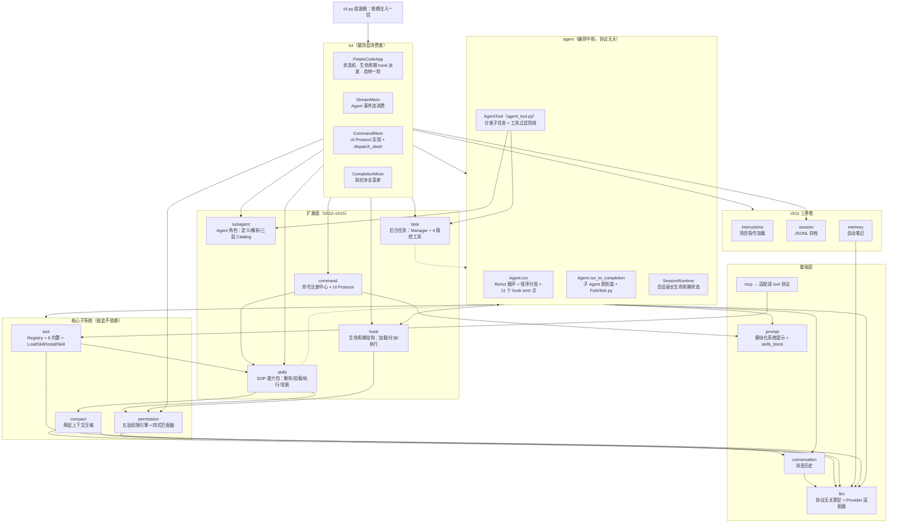
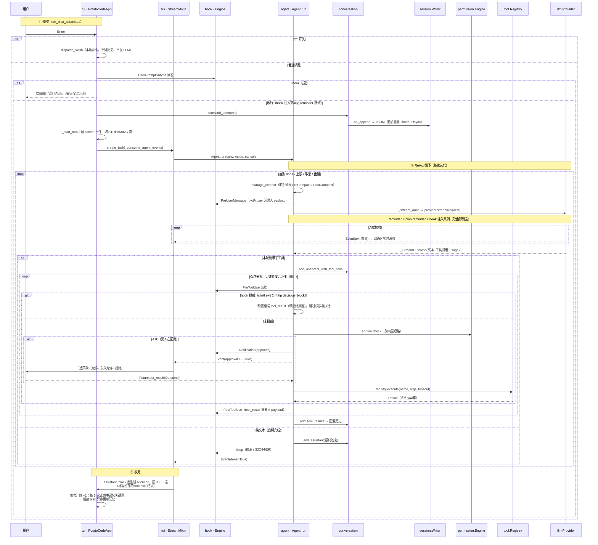

# PotatoCode 架构总览

> 覆盖范围：main 分支 ch02–ch15 已交付能力。
> 本文是 `docs/ch04/architecture.md`（七层架构，仅覆盖到 ch04）的全系统扩展版，后者作为历史记录保留。
> 代码引用以 `文件:符号名` 为主，行号会随版本漂移，仅常量定义处标注。

---

## 一、定位与演进脉络

PotatoCode 是一个用 Python 3.12+ / Textual / Rich 实现的终端 AI 编程助手，明确对标 Claude Code。项目采用 spec 驱动开发：每章在 `docs/chXX/` 下依次产出 spec → plan → task → checklist，架构逐章"长"出来，每章完成一次能力跃迁：

| 章节 | 能力 | 跃迁 |
|---|---|---|
| ch02 | 多协议 LLM 对话客户端（Anthropic / OpenAI，流式） | 打通「人 ↔ LLM」最小闭环 |
| ch03 | 工具系统（6 个内置工具） | 聊天机器人 → 能干活的 Agent |
| ch04 | Agent Loop（ReAct 循环） | 一步一停 → 自主多轮 |
| ch05 | 系统提示工程化（模块化 + prompt cache + reminder） | 能干活 → 干得好 |
| ch06 | 五层权限系统 | 裸奔 → 护栏内自主 |
| ch07 | MCP 客户端 | 工具写死 → 生态可插拔 |
| ch08 | 上下文压缩（两层） | 会话变长必崩 → 长会话不崩 |
| ch09 | 工具遍历范围修订（修订章） | 修正 ch03 的 glob / grep 行为 |
| ch10 | 日志落盘（会话目录内 session.log） | 可观测性 |
| ch11 | 项目指令 / 会话存档 / 自动记忆 | 每次失忆 → 越用越懂你 |
| ch12 | slash 命令体系（command 包：注册中心 + UI Protocol） | 本地操作绕过 LLM、命令中心化 |
| ch13 | Skill 系统（skills 包：SOP 能力包 + LoadSkill / InstallSkill） | prompt 手敲 → 可复用可分发的 SOP 包 |
| ch14 | Hook 生命周期挂钩（hook 包 + 权限匹配器四式扩展） | 显式触发 → 生命周期时刻自动动作 |
| ch15 | SubAgent 机制（subagent/task 包 + Agent 工具 + 后台任务） | 单 Agent → 主从任务分发 |

---

## 二、分层架构与依赖方向



三条铁律（自 ch04 确立，代码始终遵守）：

1. **上层依赖下层、单向调用**。`llm` 是全项目的共享词汇表（`Message` / `ToolCall` / `ToolResult` / `ToolDefinition` / `Usage` / `StreamEvent` / `Provider` Protocol）——人人依赖它，它零依赖。
2. **agent 层协议无关**：只认 `Provider` Protocol，不 import anthropic / openai SDK（`agent/__init__.py` 模块 docstring 明示）。ch13 的 skills 包需要构造临时 Agent，同样只在函数体内局部 import `agent`，避免反向依赖。
3. **扩展面一律窄协议解耦**（ch12–ch15）：命令 handler 只认 `UI` Protocol（`command/ui.py`），App 经 `CommandMixin`（`tui/commands.py`）实现；fork skill 的宿主依赖走 `SkillHost` 窄协议（`skills/executor.py`）；hook 引擎允许为 None（未注入时全部 emit 为空操作）；ch15 的 AgentTool 只认 `SubAgentCatalog` / `TaskManagerLike` 两个结构化 Protocol，task 包对 agent 仅 TYPE_CHECKING 引用。skills / hook / command / subagent / task 五个包都不 import Textual、不反向依赖 tui。

`cli.py` 是组装根（composition root）：加载配置 → 指令/记忆索引 → 会话上下文与日志 → 扫描两级 skill 目录并注册内置工具（含 LoadSkill / InstallSkill）+ MCP 工具 → **加载三层 Agent 角色目录（subagent.load_catalog）→ 构造 task.Manager 并注册 4 个 task 工具与 Agent 工具** → 权限引擎 → 加载两层 hooks.yaml → SessionRuntime → 启动 TUI（注入 skill / hook / task_mgr / subagent_catalog 全套；Agent 工具经 getter 回填主 Agent 与主对话）→ App 退出后兜底派发 SessionEnd。

---

## 三、一次对话的完整数据流



**双通道输出**（tui 层核心设计）：`#streaming` 动态区只放流式中内容（spinner、增量文本、执行中工具、迭代进度），随时整体重绘；`#log` RichLog 只放定型内容（用户块 / 工具行 / 结果摘要 / 最终答复 / 系统提示），可滚动回看。两者由同一事件流驱动、互不感知。

---

## 四、Agent 循环（agent/）

> 文件分工：ReAct 循环本体在 `agent/__init__.py`；`agent/runtime.py` 是长生命周期状态容器；`agent/event.py` 是压缩生命周期事件。

### 4.1 事件模型

`Event`（`agent/__init__.py`）是 Agent 对外事件流的唯一元素，TUI 按非默认字段分派渲染：

| 字段 | 含义 |
|---|---|
| `text` | 模型文本增量（preamble 或最终答复） |
| `tool` | 工具调用开始/结束（`ToolEvent`：name / args / phase / result / is_error） |
| `approval` | 待批准的工具调用（`ApprovalRequest` + `asyncio.Future[Outcome]`） |
| `usage` | 本轮 token 用量（input / output / cache_write / cache_read） |
| `iter` | 迭代轮次进度 |
| `notice` | 系统提示（停止原因等），仅 UI 展示、不入历史 |
| `compact` | 压缩生命周期事件（AUTO / EMERGENCY × BEFORE / AFTER） |
| `done` / `err` | 本轮终止 |

整体是**纯 pull 模型的异步生成器管道**（provider.stream → Agent.run → `_consume_agent_events`），没有事件总线。ch14 的生命周期 hook **不走这条事件流**：agent / tui 在 11 个固定时刻同步调用 hook 引擎 `dispatch`（见第八章），hook 注入的文本经 `SessionRuntime.pending_reminders` 进下一轮请求的 reminder。

### 4.2 停止条件与历史不变量

停止条件（F2）：自然完成 / `MAX_ITERATIONS = 25` / 用户取消 / 连续 `MAX_UNKNOWN_RUN = 3` 轮整轮未知工具 / 流出错。自然完成路径在 `yield done` 之前派发 Stop hook（取消 / 出错不触发，ch14 F9）。

**历史合法性兜底（F6）**：任何提前终止都会经 `_ensure_assistant_tail` 补齐 assistant 文本尾巴、未执行工具补「已取消」占位结果，保证 tool_call/tool_result 配对与角色交替——下一轮请求不被 API 拒。

### 4.3 工具分发：保序分批（`_execute_batched`）

- 向前吃**连续只读工具**的最长区间合并为并发批（`registry.is_read_only`）；有副作用的工具单个串行，保持模型输出顺序
- 每个工具执行前先派发 **PreToolUse hook**（ch14 G6）：拦截（shell `exit 2` / http `decision=block`）→ 直接预置带拒绝原因的错误 tool_result，**跳过权限引擎与执行**；未拦截才进权限判定
- 只读批：逐个过权限引擎（只读永不 Ask），Deny 预置错误结果，Allow 并发执行
- 副作用：Allow 执行 / Deny 拒绝 / **Ask → 人在回路**（派发 Notification(approval) 后发 `ApprovalRequest` 事件、`await respond`）；用户选「永久允许」时调 `engine.persist_local_allow` 写入本地规则文件
- 拿到结果后派发 **PostToolUse hook**（tool_result 摘要与 is_error 入 payload）
- `_run_batch` 用 `asyncio.wait(FIRST_COMPLETED)` 同时监听工具任务与 cancel 事件，取消时补齐占位结果

### 4.4 撞墙重试与 hook 注入

`PromptTooLongError`（`llm/errors.py` 把两协议 400 超长异常统一包装）→ 发 `BEFORE_EMERGENCY` 事件 → 紧急压缩 → 重试本请求一次。主对话每次成功请求后用**真实 usage 替换锚点**（`usage_anchor`），供压缩层增量估算。三条压缩触发路径（AUTO / MANUAL / EMERGENCY）都在 `manage_context` 前后派发 PreCompact / PostCompact；流出错与权限 Ask 弹出时派发 Notification。

hook 的 prompt 动作产生的注入文本进 `SessionRuntime.pending_reminders` 队列，下一次 `_stream_once` 装配 reminder 时取出拼进请求（plan reminder 之后），**本轮有效、不入持久历史、不参与压缩**。

`run` 与 `run_force_compact`（手动 `/compact`）通过会话级 `asyncio.Lock` 互斥，防止并发改写历史。

### 4.5 SessionRuntime（`agent/runtime.py`）

TUI 历史上每轮重建 Agent，压缩相关状态若放 Agent 字段会被逐轮重置（决策冻结、熔断器立刻失效），因此收拢到这个由 TUI 持有、注入 Agent 的长生命周期容器：替换决策账本 `replacement`、文件追踪 `recovery`、自动摘要熔断器 `auto_tracking`、会话上下文 `session`、上下文窗口、用量锚点、轮次计数；ch14 增加工作目录 `workspace`（hook payload 的 cwd 字段）、hook 注入队列 `pending_reminders` 与 `hook_engine` 引用。`reset_for_new_session`（/clear、/resume 切会话）同步清空 reminder 队列并重置 hook 引擎的 only_once 集合。

### 4.6 子 Agent 扩展（ch15）

Agent 类新增 6 个构造参数（主 Agent 全部走默认值，行为不变）：`system_prompt`（覆盖默认系统提示）、`max_turns`（迭代上限，0=全局 25）、`permission_mode`（子 Agent 模式兜底）、`dont_ask`（Ask 自动放行）、`approval_upgrader`（Ask 升级父 TUI 回调）、`provider_override`（模型覆盖时换 provider）；并暴露 `provider / registry / version / hook_engine` 只读访问器供 AgentTool 取父依赖。

- **`run_to_completion(conv, task, events=None)`**（`agent/__init__.py`）：与 `run` 共用 `_run_iterations` 全部逻辑（权限、hook、压缩、历史收尾），只是事件改为内部消费——进度事件可转发到 `events` 队列（Manager 聚合 / TUI 渲染），审批事件自动拒绝（无人值守安全默认）。返回最后一条 assistant 文本；触达 max_turns 抛 `MaxTurnsReached(final_text)`；出错上抛。`task` 空串不追加 user 消息（Fork/Skill fork 已预装填）
- **Ask 分支三层链**（`_execute_batched` 内）：`dont_ask` → 自动 Allow；`approval_upgrader` → 交父 TUI 裁决（升级失败回退默认 emit 路径）；否则原 emit 路径
- **Fork 辅助**（`agent/fork.py`）：`build_forked_messages` 深拷贝父消息 + 补齐末尾悬空 tool_use 占位结果 + 追加 `<fork_boilerplate>` 任务消息（保历史合法性与 prompt cache 前缀，N2）；`is_fork_context` 按 Boilerplate 标记识别 Fork 对话
- **调用深度标记**（`agent/subagent_context.py: SUBAGENT_DEPTH`，ContextVar）：Agent 工具启动子 Agent 前深度 +1（前台 await 与后台 create_task 均继承），入口发现深度 > 0 即拒绝——F24 QuerySource 的协程上下文实现，`launch_fork` 与 `Manager.send_message` 续派路径同样加标记
- **公共 Fork 启动**（`agent/launch.py: launch_fork(ForkLaunchOpts)`）：Skill fork（ch13）复用的 SubAgent 底座——全新 `new_sub_runtime`（compact 状态全新、session 标识沿用父、不落盘）+ 受限注册中心 + `run_to_completion`

---

## 五、横切子系统

### 5.1 权限：五层短路链（permission/）

```
① 黑名单（不可配置，bypass 模式也拦）
② 路径沙箱（symlink 解析 + 工作区前缀判定）
③ 三级规则文件（~/.potatocode/settings.yaml 用户级、<project>/.potatocode/settings.yaml 项目级、settings.local.yaml 本地级；跨层 deny 全优先）
④ 模式兜底矩阵（default / acceptEdits / plan / bypassPermissions，只产 Allow / Ask）
⑤ 人在回路（TUI 三选菜单）
```

`Engine.check`（`permission/engine.py`）是前四层的唯一入口，逐层短路。权限被拒时把结构化拒绝**回灌**给模型让它调整策略，而非终止 Agent Loop。四档模式由 Shift+Tab 循环切换；PLAN 模式只给模型只读工具定义。

规则匹配语法自 ch14 起升级为**四式 Matcher**（`permission/matcher.py: compile_matcher`）：`=value` 精确（整串相等）/ `~regex` 正则（加载期编译缓存）/ `!inner` 反向（可嵌套，如 `!=v`）/ 无前缀 glob（命令类整串通配、路径类分段通配）。Hook 条件表达式共用同一套 Matcher 实现避免两套语义漂移；规则解析失败由原来的静默跳过改为 stderr 提示后跳过、其余规则正常加载。

分类归类（`permission/settings.py: categorize`）：`read_only` 工具（含 LoadSkill）→ READ，write_file / edit_file → WRITE，bash 与未知工具（含 InstallSkill、MCP、Agent）→ EXEC（N7 最严）。

已知边界：friendly_name / extract_target 只认识 6 个内置工具；MCP 工具与 InstallSkill 在分类中归 EXEC、落到规则/模式兜底。

**子 Agent 权限三层升级链**（ch15 F12）：子 Agent 工具调用走到 Ask 时——① 父对话已批准账本（父 Engine 持久化的精确规则）照常在规则层命中放行 → ② 角色 `permissionMode` 兜底：`dontAsk` 一律放行 Ask、`plan`/`acceptEdits`/`bypassPermissions` 经 mode 入参走原矩阵 → ③ 仍 Ask 且挂了 `approval_upgrader` 则升级主 TUI 弹窗（reason 带「来自 SubAgent X」标识，子 Agent 暂停等待）；无消费者时回退默认路径并由 `run_to_completion` 自动拒绝。

### 5.2 上下文压缩：两层三触发（compact/）

**第 1 层（layer1.py，纯字符串、不调 LLM）**：超限工具结果原文落盘到 `<session_dir>/tool-results/<tool_use_id>`，对话内替换为「字节数 + 头部预览（20 行 / 2KB）+ 落盘路径 + 重读提示」。替换决策经 `ContentReplacementState.decide_once` 临界区**冻结**——同一 id 后续每轮复用同一预览串，保证 prompt cache 前缀逐字节稳定。触发线：单条结果 > 50KB 或单条消息聚合 > 200KB（`compact/const.py`）。

**第 2 层（layer2.py，LLM 全量摘要）**：摘要请求不传工具；输出固定 9 小节（含「所有用户消息原文」「当前工作最详细」）；结果 =「摘要 + 恢复附件（最近读过的 ≤5 个文件快照、当前可用工具列表、边界提示）」合成一条 user 消息 + 近期原文尾巴（≥10000 token 且 ≥5 条，配对修正不切开 tool_use/tool_result）。

**三种触发**（`compact.py: manage_context`，均已接入 PreCompact / PostCompact hook）：

| 触发 | 时机 | 阈值 |
|---|---|---|
| AUTO | 每轮请求前必查 | `context_window − 20000(SUMMARY_RESERVE) − 13000(AUTO_SAFETY_MARGIN)` |
| MANUAL | `/compact` 命令 | 跳过阈值与熔断 |
| EMERGENCY | provider 抛 PromptTooLongError | 强制第 1 层 + 摘要，重试一次 |

**自保护**：熔断器（连续 3 次自动摘要失败跳闸，只封自动路径）；摘要请求自身撞 PTL 时先直接重试 3 次，再每次丢最旧 20% 消息组。token 估算不引入 tokenizer：锚定上次真实 usage + 字符增量粗估（3.5 字符/token）。第 2 层摘要管道还被 skill fork 的 `context=full` 档复用（ch13）。

### 5.3 记忆三件套（ch11，三层互相独立、配合作战）

| 层 | 模块 | 机制 |
|---|---|---|
| 项目指令 | `instructions/` | 三层路径合并（项目根 > `.potatocode/` > `~/.potatocode/` 的 `POTATOCODE.md`），高优先级在前拼接注入系统提示；支持 `@include` 嵌套引用（限 5 层、环路检测、路径逃逸检测） |
| 会话存档 | `session/` | 对话历史逐条 JSONL 追加（flush + fsync，崩溃最多丢一行）；压缩时写 `type: compact` 标记行；`/resume` 恢复（跳坏行 / 只取最后压缩标记之后 / 截断悬空工具调用 / 超限先压缩 / >6h 提醒时间跨度）；30 天过期会话启动时自动清理 |
| 自动笔记 | `memory/` | 每 5 轮自然结束（`MEMORY_UPDATE_INTERVAL`）或命中「记住 / remember」等关键词时，后台 task 请 LLM 产出 JSON 操作数组（create / update / delete），`asyncio.Lock` 串行化维护两级笔记库（项目 `.potatocode/memory/`、用户 `~/.potatocode/memory/`）；一条笔记 = 带 YAML frontmatter 的 Markdown，`MEMORY.md` 索引注入系统提示（上限 25KB） |

### 5.4 MCP（mcp/）：适配进同一工具协议

`McpTool`（`mcp/tool.py`）把远端工具适配成 `Tool` Protocol，命名 `mcp__<server>__<tool>`，`read_only` 取 annotations.readOnlyHint，30s 超时。`Manager`（`mcp/manager.py`）并发连接（失败仅跳过不阻断启动）、stdio / streamable-http 双传输、启动时固定工具快照。MCP 工具注册进同一 Registry，对 Agent 完全透明，自动继承权限护栏。

---

## 六、slash 命令体系（command/，ch12）

命令域整体搬出 TUI：`command` 包是纯领域逻辑（不 import Textual），TUI 经 `CommandMixin`（`tui/commands.py`）实现其 UI 抽象并桥接分发。

- **数据结构**（`command/command.py`）：`Command(name / aliases / description / kind / handler / hidden / accepts_args / args_handler)`；`Kind` 三类——LOCAL（只输出信息，不改状态、不进历史）、UI（改运行时状态 / 换会话 / 退出，不进历史）、PROMPT（注入 user 消息并立即触发一轮 LLM，与真实消息同一条持久化路径，scrollback 只展示 display_label）
- **注册中心**（`command/registry.py: Registry`）：主名与别名同表映射；**启动期冲突检测**——名字 / 别名重复、非法形态（空名、含大写）、声明 accepts_args 却缺 args_handler 一律立即抛错终止启动；`visible()` 按名字字典序（/help 与补全菜单的唯一数据源）；`prefix_match` 只按主名前缀过滤；`unregister` 供 skill 命令重建摘除
- **分发**（`command/dispatch.py: parse_with_args`）：`/` 开头走命令路径；参数尾巴只有命令声明 accepts_args 才消费，否则按未命中；未命中输出「输入 /help 查看可用命令」引导；大小写不敏感
- **桥接与守护**（`tui/commands.py: CommandMixin.dispatch_slash`）：UI / PROMPT 类命令仅 IDLE 态可执行（`/exit` 例外）；handler 异常捕获后以错误样式输出，不打断 TUI
- **UI Protocol**（`command/ui.py`）：handler 操作界面的唯一通道——输出（println / error）、权限模式读写、`inject_and_send` 提示词注入、只读查询（token / 模型 / 工具数 / 记忆文件 / 会话路径）、影响界面动作（quit / force_compact / open_resume_menu / clear_and_new_session）、hook 查询、skill 支持；附 `NopUI` 测试桩
- **命令清单**：13 条内置（ch12 的 clear / compact / do / exit / help / memory / permission / plan / resume / review / session / status + ch14 的 hooks，`command/builtins.py`）+ `/skill` 管理命令（ch13，accepts_args：list / info \<name\> / reload）+ **每个 skill 一条同名斜杠命令**（描述带 `[skill]` 后缀；inline 注册为 PROMPT、fork 注册为 UI；与内置命令同名时 skill 覆盖——unregister 后重注册，reload 幂等重建）
- **补全菜单**（`tui/complete.py: CompletionMenu`）：输入以 `/` 开头即激活，按 `prefix_match` 实时过滤候选；↑↓ / Tab / 回车 / ESC 全键位、8 行滚动窗口、零匹配显示占位提示；任何提交先关菜单

---

## 七、Skill 系统（skills/，ch13）

把可复用 SOP 装进「带 YAML frontmatter 的 Markdown 能力包」，渐进式披露：系统提示只注入 name + description，完整 SOP 经**消息通道**按需进入对话（不进系统提示、不钉 env）。

- **解析**（`skills/parser.py: SkillDef`）：`name / description / prompt_body / mode(inline|fork) / model(预留) / context(full|recent|none，仅 fork 生效) / source_path / is_directory`；name 限 `^[a-z][a-z0-9\-]*$`；`substitute_arguments` 把 SOP 正文里的 `$ARGUMENTS` 替换为调用参数（无占位符原样返回）
- **磁盘布局**：单个 `<name>.md` 或目录型 `<name>/SKILL.md`（可另带 references/ 资源）
- **加载**（`skills/loader.py: SkillLoader`）：两级扫描 项目 `.potatocode/skills/` > 用户 `~/.potatocode/skills/`，同名先到先得；单条解析失败 warning 跳过不阻断；`get()` 每次重读源文件实现**热重载**，解析失败回退 `_cache` 旧版本
- **SOP 交付三路**（全部走消息通道）：
  - inline 斜杠命令 → SOP 作为 user 消息注入并触发回合（`inject_and_send`）
  - inline LoadSkill 工具 → SOP 直接进 tool_result，模型当轮即见、后续轮次留在历史
  - fork → `SkillExecutor.spawn_fork` 后台子 Agent，最终文本作为 assistant 消息回流主对话（流式进行中先入暂存队列，回合收尾 `_flush_pending_skill_results` 补写，避免插进 tool 配对中间破坏历史合法性）
- **Available Skills 目录**（`prompt/skills_block.py`）：系统提示 90 槽渲染 `- name: description` 清单 + LoadSkill 调用指引；启动期注入，/skill reload 与安装后经 `agent.set_skill_catalog` 刷新
- **LoadSkill 工具**（`tool/load_skill.py`）：read-only——不弹权限提示、PLAN 模式可用；宿主依赖经 `SkillHost` 窄协议注入，tool 包不反向依赖 TUI
- **InstallSkill 工具**（`tool/install_skill.py` → `skills/install.py`）：用户把 URL 发给 Agent 即自动安装到 `~/.potatocode/skills/<name>/`；支持 skills.sh / github tree / raw 三种 URL，一律走 GitHub Contents API 递归拉取（raw 媒体类型取文件内容，download_url 仅回退）；限额单文件 ≤1MiB / 总量 ≤8MiB / 文件数 ≤64 / 深度 ≤4；先暂存到安装根的兄弟 tempdir、验证含 SKILL.md 后原子改名落位；装完自动 rebind（重建斜杠命令 + 刷新 Agent 目录），无需重启
- **fork 隔离**（`skills/executor.py`）：独立 Conversation + 全新 SessionRuntime（沿用主会话 id 但不挂 writer、不落盘）+ 剔除 LoadSkill 的子 Registry（防递归加载）；fork 内权限询问一律自动拒绝（无人值守安全默认）；`context` 档——none 空 / recent 最近 5 条纯文本（跳过带工具调用的回合）/ full 复用 compact 第 2 层摘要管道；上下文 + SOP 做角色规范化（合并连续同角色、去开头 assistant）保证历史合法；宿主能力面全部经 `SkillHost` 协议注入

---

## 八、Hook 生命周期挂钩（hook/，ch14）

在 Agent 生命周期的 11 个固定时刻自动执行用户在 YAML 里声明的「事件 + 条件 + 动作」，把「触发条件明确、动作固定」的重复工作机器化。

- **配置加载**（`hook/loader.py: load`）：扫描 项目 `.potatocode/hooks.yaml` → 用户 `~/.potatocode/hooks.yaml`，两层规则**叠加合并**（无覆盖概念）；跨文件同名 hook 保留先到者；所有加载错误（坏文件 / 坏规则 / 正则编译失败 / 拦截类配 async）一律 stderr 提示后跳过，**绝不阻断启动**
- **规则结构**（`hook/rule.py: Rule`）：`name / event / if(条件，可省略=无条件) / action / only_once(会话内一次) / async(后台异步) / timeout(默认 30s)`；条件 = `AtomCondition(field 点分路径 + Matcher)` 按 `all_of / any_of` 二选一组合，**不嵌套混用**（G5）
- **四种动作**（`hook/executor.py: Executor`）：
  - `shell`：命令由 `sh -c` 解释（Windows 上探测 Git Bash 的 sh.exe），payload JSON（key 字典序）从 stdin 传入；拦截类事件下 `exit 2` 表达拦截、stderr 为拒绝原因；其它非零退出只算 hook 失败不拦截
  - `prompt`：文本注入下一轮 reminder，永不拦截
  - `http`：缺省 body = payload JSON，body 支持 `format_map` 模板；2xx + 响应体 `{"decision":"block"}` 表达拦截
  - `subagent`：本期占位不实现
- **11 个事件与派发位置**（`hook/event.py: Event`）：

| 事件 | 派发位置 | 可拦截 |
|---|---|---|
| SessionStart | TUI on_mount（env 装配完、首条消息前）；/clear 新会话 | 否 |
| SessionEnd | TUI /clear（旧会话）；cli 进程退出兜底 | 否 |
| SessionResume | TUI /resume | 否 |
| UserPromptSubmit | TUI 提交后、写历史前 | 是（拒绝 → 错误块回显原因，输入保留） |
| PreUserMessage | `agent/_stream_once` 调 provider.stream 前 | 否 |
| PreToolUse | 权限引擎 check 之前 | 是（→ 错误 tool_result 回灌，跳过权限与执行） |
| PostToolUse | 拿到 tool_result 之后 | 否 |
| PreCompact / PostCompact | 三条压缩触发路径（AUTO / MANUAL / EMERGENCY） | 否 |
| Notification | 流出错 / 权限 Ask 弹审批 | 否 |
| Stop | 自然完成后、done 事件前（取消 / 出错不触发） | 否 |

- **执行控制**：`only_once`（按 name 记账，执行过即消耗，/clear 与 /resume 随会话重置）；`async`（起 task 后立即继续，不参与拦截与注入；拦截类事件 PreToolUse / UserPromptSubmit **禁止 async**，加载期校验）；`timeout`（shell / HTTP 最大执行时长，超时按失败处理）
- **引擎分派**（`hook/engine.py: Engine.dispatch`）：按加载声明顺序串行执行命中规则；hook 自身失败只 stderr 日志、继续后续规则；拦截类事件下首个表达拦截信号的同步规则生效后跳过同事件其余规则；注入文本经 `DispatchResult.injected_prompts` 进 `SessionRuntime.pending_reminders`
- **匹配器共享**：条件用的 Matcher 即 `permission/matcher.py` 的四式实现（=精确 / ~正则 / !反向 / glob），权限规则同批升级——一套匹配语义两处消费
- **观测**：`/hooks` 命令（`tui/hooks.py`）按 event 分组列出全部已加载规则（含 `[once]` / `[async]` 标志）与加载来源文件

---

## 九、LLM 抽象层（llm/）

**Provider 抽象 = Protocol + 工厂 + 适配器**。`Provider` 是 `@runtime_checkable` Protocol（只要求 `name` / `model` / `stream(req)`），`new_provider(cfg)` 按 protocol 字段延迟导入构造适配器。两适配器统一输出 `StreamEvent` 五态流（text / tool_calls / usage / done / err），协议差异全部内部消化：

| 差异点 | AnthropicProvider | OpenAIProvider |
|---|---|---|
| system | 拆「稳定块（cache_control: ephemeral 打缓存断点）+ 环境块」 | 单条拼接 |
| tool_result | 作为 user 消息回灌 | 按协议 role 回灌 |
| 工具调用分片 | 完整块 | 按 index 累加拼 JSON，空 arguments 归一 `"{}"` |
| usage | 流尾 usage 块 | `stream_options.include_usage` |
| reminder 注入 | 织入末条 user 的 content 块 | 追加到尾部 user 消息 |

`PromptTooLongError`（`llm/errors.py`）统一两协议的 400 超长异常，供压缩层捕获。

---

## 十、工具层（tool/）

- **Tool Protocol**：`name` / `description` / `parameters`（JSON Schema）/ `read_only` / `execute`
- **Registry**：集中登记、按名查找、导出 `definitions()`（PLAN 模式只导 `read_only_definitions()`）；`execute` 带 per-tool 超时且**永不抛异常**——未知工具 / 超时 / 异常一律包成 `Result(is_error=True)`，Agent 原样回灌给模型，从不打断循环。Agent 工具走加长超时 `AGENT_TOOL_TIMEOUT`（前台子 Agent 等待 + 缓冲，`agent/__init__.py`）
- **6 个内置工具**：`read_file` / `write_file` / `edit_file` / `bash` / `glob` / `grep`
- **2 个 Skill 桥接工具**（ch13）：`LoadSkill`（read-only，激活 skill）、`InstallSkill`（write 类，受权限约束）；二者在 cli 启动期、Agent 构造前注册，保证首轮请求即可见
- **5 个 SubAgent 工具**（ch15）：`Agent`（分发子任务，见第十五章）+ `TaskList` / `TaskGet`（只读查询）/ `TaskStop` / `SendMessage`（操控后台任务，`task/tools.py`）；子 Agent 经工具过滤防线全部不可见
- `filter.py`（ch15）：工具过滤多层防线常量（`ALL_AGENT_DISALLOWED_TOOLS` / `CUSTOM_AGENT_DISALLOWED_TOOLS` / `ASYNC_AGENT_ALLOWED_TOOLS`）与 `apply_agent_tool_filter` 五层顺序过滤（F30）、`build_sub_registry` 受限子注册中心
- `exclude.py`：统一维护遍历排除规则（.git、node_modules 等，ch09）

---

## 十一、TUI 层（tui/）

- **组合结构**：`PotatoCodeApp(CompletionMixin, CommandMixin, TasksMixin, StreamMixin, App)`（`tui/app.py`）——四个 Mixin 分别负责补全菜单、命令桥接、后台任务消费（ch15）、事件流消费
- **状态机**（`tui/view.py`）：`SELECTING → IDLE ⇄ STREAMING ⇄ APPROVING`，外加 `RESUMING`
- **StreamMixin**：Agent 事件流消费端；APPROVING 态菜单键（↑↓ / 回车 / 数字 / y / n / d）由 `ChatTextArea._on_key` 前置拦截分派——TextArea 默认吞 enter，binding 无法覆盖。审批弹窗受 `approval_menu_lock` 串行化、结束后恢复 `_approval_prev_state`（ch15：主 Agent 弹窗=STREAMING，后台子 Agent 升级弹窗=IDLE）
- **CommandMixin**（`tui/commands.py`）：实现 UI Protocol 全部方法 + `dispatch_slash` 入口（idle 守护 / 未命中提示 / 异常兜底）；`clear_and_new_session` 串接 SessionEnd → 换 writer / conv / runtime → SessionStart；fork skill 结果回流经暂存队列在回合收尾补写
- **TasksMixin**（`tui/tasks.py`，ch15）：`_consume_task_done` 把后台任务终态渲染为 `<task-notification>` 注入 `runtime.pending_reminders`（只对模型可见，N7）；`_consume_subagent_approvals` 消费 Manager 审批升级队列，与主弹窗共用菜单锁串行展示「来自 SubAgent」审批
- **CompletionMixin**（`tui/complete.py`）：斜杠命令补全菜单（见第六章）
- **生命周期 hook 派发点**：on_mount 末尾 SessionStart；/clear 旧会话 SessionEnd + 新会话 SessionStart；/resume SessionResume；提交路径 UserPromptSubmit（可拦截）；on_mount 同时启动 ch15 的两个后台消费协程（task_mgr 已注入时）
- **取消语义**：Ctrl+C 流式态取消本轮、空闲态退出；Esc 取消；取消经共享 `asyncio.Event`（turn_cancel）注入，Agent 在下个 await 点响应。前台子 Agent 被工具层取消时，AgentTool 会连带 cancel 子 Agent 任务（防孤儿跑动）

---

## 十二、系统提示装配（prompt/）

- **模块化**：`Module(name, priority, content)` 按优先级稳定排序拼接；7 个固定模块（10 身份 / 20 系统约束 / 30 任务模式 / 40 动作执行 / 50 工具使用 / 60 语气风格 / 70 文本输出）+ 3 个可选槽（80 自定义指令 / 90 **可用Skill**——ch13 起承载 Available Skills 目录文本 / 100 长期记忆），空内容自动跳过
- **SOP 不进系统提示**：skill 的 SOP 正文走消息通道（user 消息 / tool_result / fork 子 Agent），系统提示 90 槽只有 name + description 清单——目录内容稳定，可进缓存前缀
- **缓存通道分离**：稳定内容（固定模块 + 指令 + 记忆 + skill 目录）打缓存断点走可缓存通道；环境段（工作目录 / 平台 / 日期 / git status 摘要 / 版本 / 模型，`environment.py`）单独成段不打断点——每轮变化的内容不破坏缓存前缀
- **reminder 走消息通道**：`<system-reminder>` 标签包裹的补充指令注入消息流而不污染缓存；Plan 模式提醒首轮完整、每 `PLAN_REMINDER_INTERVAL = 4` 轮重复完整、其余精简；hook 注入文本（ch14）拼接在 plan reminder 之后，本轮有效
- `/do` 注入执行指令（`EXECUTE_DIRECTIVE`）后走与普通消息完全相同的流程

---

## 十三、配置与运行时布局

**四套 YAML 配置**：

| 文件 | 用途 | 要点 |
|---|---|---|
| `.potatocode/config.yaml`（模板 config.yaml.example） | providers + 开关 | name / protocol(anthropic\|openai) / api_key / model / base_url? / thinking? / context_window?（0=协议默认 200000 / 128000，决定压缩阈值）；顶层 `enable_subagent_background?`（ch15 N6，默认 true，false 时所有子 Agent 强制前台） |
| `.potatocode.yaml`（项目根，用户级 `~/.potatocode/config.yaml`） | MCP servers | type(stdio\|http)；env / headers 支持 `${VAR}` 环境变量展开；同名 server 项目级完整覆盖用户级 |
| `.potatocode/settings(.local).yaml`（用户级 `~/.potatocode/settings.yaml`） | 权限 | default_mode（default / acceptEdits / plan / bypassPermissions）+ permissions.allow / deny；规则串四式语法 `Bash(=精确)` / `Bash(~正则)` / `Bash(!反向)` / `Bash(glob)`（ch14）；三级：用户 > 项目 > 本地，「永久允许」自动写入 local |
| `.potatocode/hooks.yaml`（用户级 `~/.potatocode/hooks.yaml`） | hooks（ch14） | `hooks:` 数组：name / event(11 选 1) / if?(all_of\|any_of + field/match) / action(shell\|prompt\|http\|subagent) / only_once? / async? / timeout?；两层叠加合并 |

**运行时目录**：

```
.potatocode/
├── sessions/<YYYYMMDD-HHMMSS-xxxx>/   # 每次启动一个会话目录
│   ├── conversation.jsonl             # 对话存档（逐条 fsync）
│   ├── tool-results/<tool_use_id>     # 第 1 层压缩的落盘原文
│   └── session.log                    # ch10 运行日志
├── memory/                            # 项目级笔记库 + MEMORY.md 索引
├── skills/                            # 项目级 skill 目录（<name>.md 或 <name>/SKILL.md）
├── agents/*.md                        # 项目级 Agent 角色定义（ch15，frontmatter+正文）
├── hooks.yaml                         # 项目级 hook 规则
└── settings.local.yaml                # 「永久允许」自动写入
~/.potatocode/                         # 用户级：config.yaml / settings.yaml / hooks.yaml / memory/ / skills/ / agents/
```

会话 id 在启动最前端生成（先建日志出口再建其余组件，两者指向同一会话，见 docs/ch10/spec.md F2），由 `SessionRuntime.session` 贯穿：存档、工具结果落盘、日志、`/resume` 恢复共用。

---

## 十四、贯穿全局的设计原则

1. **降级哲学**：工具失败、压缩失败、记忆更新失败、会话恢复失败、hook 自身失败、配置解析失败——一律包成结构化错误回灌模型或 stderr 记日志跳过，**永不打断主对话**（hook 加载错不阻断启动、命令 handler 异常不炸 TUI）。
2. **结构化结果，不抛异常**：工具层恒返 `Result`；权限拒绝恒为可回灌的 Decision；LLM 超长异常统一包装为 `PromptTooLongError` 供压缩层处理。
3. **缓存前缀稳定**：系统提示模块化排序、第 1 层压缩的替换决策冻结、环境段与 reminder 走独立通道、hook 注入只进消息——一切设计向「稳定内容逐字节复用 prompt cache」看齐。
4. **历史合法性不变量**：任何路径（取消 / 出错 / 上限）退出循环后，对话历史必须保持 tool_call/tool_result 配对与角色交替；fork 结果回流也要等回合收尾再补写。
5. **扩展面窄协议化**：命令 handler 只认 `UI` Protocol、fork skill 只认 `SkillHost`、hook 引擎可空注入——扩展子系统不反向依赖 TUI、不 import Textual，测试可换 `NopUI` / 空引擎。
6. **文档与代码同源**：docstring 密集引用 spec 编号（F2 / F6 / F35…），对应 `docs/chXX/spec.md`；本章架构文档是 ch04 版的全系统扩展。

---

## 十五、SubAgent 机制（subagent/ task/ + agent 扩展，ch15）

从单 Agent 进化到主从任务分发：主 Agent 经 **Agent 工具**把独立子任务交给子 Agent（定义式 / Fork 式），子任务可前台同步跑、超时或显式转后台，完成后经 `<task-notification>` 回流主对话。

### 15.1 角色定义与目录（subagent/）

- **定义文件**：Markdown + YAML frontmatter（`name` / `description` 必填；`tools` 白名单 / `disallowedTools` 黑名单 / `model` / `maxTurns` / `permissionMode`（含子 Agent 专属 `dontAsk`）/ `background` 可选），正文即子 Agent system prompt（`subagent/parser.py: parse_definition`；未知 model/permissionMode 警告降级不阻断，必填缺失抛错）
- **三层 Catalog**（`subagent/catalog.py: load_catalog`）：内置（`subagent/builtin/*.md` 经 `importlib.resources` 随包发布，解析失败 fail-fast N4）→ 用户 `~/.potatocode/agents/` → 项目 `<root>/.potatocode/agents/`，同名高优先级覆盖；加载错误 stderr 跳过；插件级占位恒空（F8）
- **内置 3 角色**：`general-purpose`（全工具）/ `Explore`（禁写、haiku）/ `Plan`（plan 模式、15 轮）

### 15.2 Agent 工具（agent/agent_tool.py）

- **参数**（F1）：`prompt` / `description` 必填，`subagent_type`（留空走 Fork）/ `model`（预留）/ `run_in_background` / `name`（SendMessage 寻址）可选；description 动态列出可用角色，工具列表对模型稳定（G1/N1）
- **两种模式**（G3）：定义式 = 空白对话 + 角色 system prompt；Fork 式 = `build_forked_messages` 克隆父历史 + Fork Boilerplate，强制后台（F18），任务文本随 Boilerplate 进首条 user 消息
- **前台同步**：`asyncio.wait` 等 `run_to_completion` 完成，返回 final_text；超 `AUTO_BACKGROUND_SECONDS=120s` 转后台，返回 `{"task_id","status":"timed_out_to_background"}`（F17-②；Registry 对 Agent 工具用加长超时 `AGENT_TOOL_TIMEOUT` 防止 30s 默认超时误杀）；显式 `run_in_background` 直接 `Manager.launch` 返回 `async_launched`（F17-①）。N6 配置关闭后台时全部强制前台、Fork 报错
- **工具过滤五层防线**（F26-F30，`tool/filter.py`）：全局禁 `Agent` → 自定义追加禁用（空）→ 后台白名单交集（基础读写 + LoadSkill/InstallSkill + `mcp__` 前缀动态识别）→ 定义黑名单 → 定义白名单；结果经 `build_sub_registry` 落成子注册中心。**例外**：Fork 子 Agent 工具列表保留 Agent 工具（AC5），调用时被深度标记拦截

### 15.3 嵌套阻断三道闸（F24）

① 工具列表层：定义式子 Agent 被 `ALL_AGENT_DISALLOWED_TOOLS` 剔除 Agent 工具；② **QuerySource**：`SUBAGENT_DEPTH` ContextVar 在启动子 Agent（前台/后台/续派/launch_fork 四条路径）前 +1，Agent 工具入口深度 > 0 即结构化拒绝；③ `is_fork_context` Boilerplate 标记扫描作为 conv 可达场景的兜底识别。

### 15.4 后台任务管理（task/）

- **`Manager`**（`task/manager.py`）：`launch` / `adopt_running`（接管前台超时任务，PartialState 并入快照）/ `get` / `list` / `stop`（cancel 跑动协程）/ `send_message`（completed 任务同 id 续派，`TaskNotFound`/`TaskBusy`）/ `subscribe_done`；跑动协程任何异常转 `status=failed`（N3/AC20）
- **`BackgroundTask`**（F15）：id / name / sub_agent / conv / task / status(running|completed|failed|cancelled) / result / err / 起止时间 / handle / usage / tool_count / last_activity（后三者由事件聚合协程维护）
- **完成通知**（F19/N7/AC12）：终态推 done 队列（满则丢弃 + stderr）→ TUI `TasksMixin._consume_task_done` 渲染 `<task-notification>` 块进 `runtime.pending_reminders`——只对模型可见、不占工具配额、不打断当前对话，主 Agent 下次 run 自然消费
- **4 个操控工具**（`task/tools.py`，F20）：`TaskList` / `TaskGet`（只读）/ `TaskStop` / `SendMessage`；对子 Agent 全部不可见（被白名单/定义白名单挡住）

### 15.5 权限与审批升级（G6/F12/F13）

见 5.1 三层升级链。升级通道：`Manager.upgrade_approval` 把 ApprovalRequest 推入审批队列（未创建/满 → (DENY_ONCE, False) 回退默认路径，绝不悬死），TUI `TasksMixin._consume_subagent_approvals` 串行弹菜单（与主弹窗共用 `approval_menu_lock`），裁决经共享 Future 回传，子 Agent 继续跑动。

### 15.6 Skill fork 收编（G10/F33）

`skills/executor.py: execute_fork` 改为构造 `ForkLaunchOpts` 后调 `agent/launch.py: launch_fork`——与 Agent 工具共用 SubAgent 底座（run_to_completion、审批自动拒绝、深度标记、new_sub_runtime）；skill 专属的按 context 档装填子对话与剔除 LoadSkill 的子注册中心保留在 executor。

### 15.7 本期边界

不实现：ESC 手动切后台（task.md T27 简化：前台仅「超时自动切后台」，Ctrl+C 仍为取消）、`model` 别名切换 provider（`provider_override` 接口就位，AgentTool 暂沿用父 provider）、`TaskCreate`、插件级定义加载、后台任务跨会话持久化。
