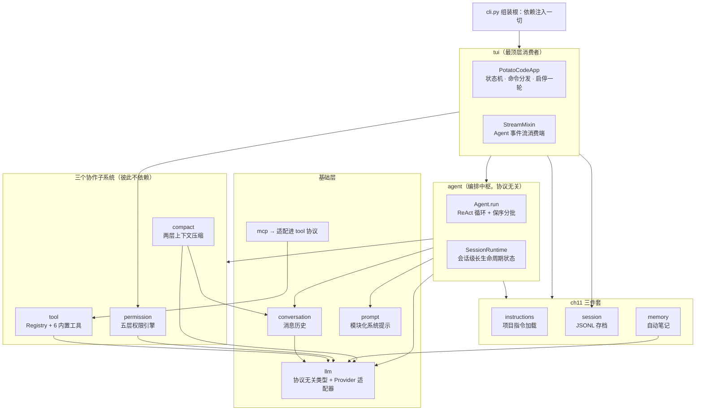
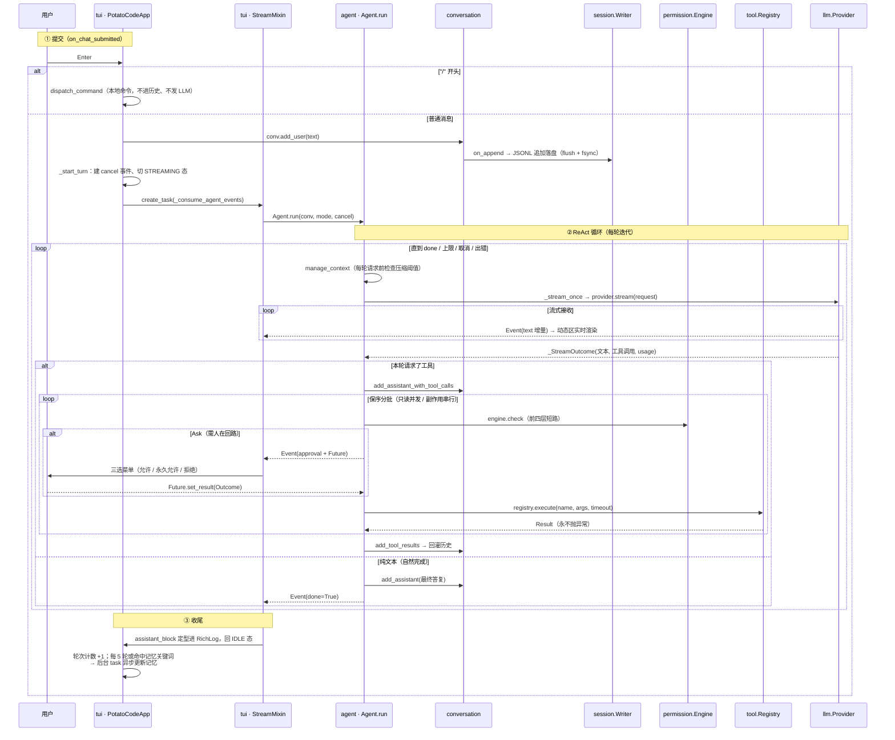

# PotatoCode 架构总览

> 覆盖范围：main 分支 ch02–ch11 已交付能力；ch12（slash 命令体系）设计已定稿、代码进行中。
> 本文是 `docs/ch04/architecture.md`（七层架构，仅覆盖到 ch04）的全系统扩展版，后者作为历史记录保留。
> 代码引用以 `文件:符号名` 为主，行号会随版本漂移，仅常量定义处标注。

---

## 一、定位与演进脉络

PotatoCode 是一个用 Python 3.12+ / Textual / Rich 实现的终端 AI 编程助手，明确对标 Claude Code。项目采用 spec 驱动开发：每章在 `docs/chXX/` 下依次产出 spec → plan → task → checklist，架构逐章"长"出来，每章完成一次能力跃迁：

| 章节 | 能力 | 跃迁 |
|---|---|---|
| ch02 | 多协议 LLM 对话客户端（Anthropic / OpenAI，流式） | 打通「人 ↔ LLM」最小闭环 |
| ch03 | 工具系统（6 个内置工具） | 聊天机器人 → 能干活的 Agent |
| ch04 | Agent Loop（ReAct 循环） | 一步一停 → 自主多轮 |
| ch05 | 系统提示工程化（模块化 + prompt cache + reminder） | 能干活 → 干得好 |
| ch06 | 五层权限系统 | 裸奔 → 护栏内自主 |
| ch07 | MCP 客户端 | 工具写死 → 生态可插拔 |
| ch08 | 上下文压缩（两层） | 会话变长必崩 → 长会话不崩 |
| ch09 | 工具遍历范围修订（修订章） | 修正 ch03 的 glob / grep 行为 |
| ch10 | 日志落盘（会话目录内 session.log） | 可观测性 |
| ch11 | 项目指令 / 会话存档 / 自动记忆 | 每次失忆 → 越用越懂你 |
| ch12 | slash 命令体系（进行中） | 本地操作绕过 LLM、注册中心化 |

---

## 二、分层架构与依赖方向



两条铁律（自 ch04 确立，代码始终遵守）：

1. **上层依赖下层、单向调用**。`llm` 是全项目的共享词汇表（`Message` / `ToolCall` / `ToolResult` / `ToolDefinition` / `Usage` / `StreamEvent` / `Provider` Protocol）——人人依赖它，它零依赖。
2. **agent 层协议无关**：只认 `Provider` Protocol，不 import anthropic / openai SDK（`agent/__init__.py` 模块 docstring 明示）。

`cli.py` 是组装根（composition root）：加载配置 → 指令/记忆索引 → 会话上下文与日志 → 注册内置工具 + MCP 工具 → 权限引擎 → SessionRuntime → 启动 TUI。

---

## 三、一次对话的完整数据流



**双通道输出**（tui 层核心设计）：`#streaming` 动态区只放流式中内容（spinner、增量文本、执行中工具、迭代进度），随时整体重绘；`#log` RichLog 只放定型内容（用户块 / 工具行 / 结果摘要 / 最终答复 / 系统提示），可滚动回看。两者由同一事件流驱动、互不感知。

---

## 四、Agent 循环（agent/）

> 文件分工：ReAct 循环本体在 `agent/__init__.py`；`agent/runtime.py` 是长生命周期状态容器；`agent/event.py` 是压缩生命周期事件。

### 4.1 事件模型

`Event`（`agent/__init__.py`）是 Agent 对外事件流的唯一元素，TUI 按非默认字段分派渲染：

| 字段 | 含义 |
|---|---|
| `text` | 模型文本增量（preamble 或最终答复） |
| `tool` | 工具调用开始/结束（`ToolEvent`：name / args / phase / result / is_error） |
| `approval` | 待批准的工具调用（`ApprovalRequest` + `asyncio.Future[Outcome]`） |
| `usage` | 本轮 token 用量（input / output / cache_write / cache_read） |
| `iter` | 迭代轮次进度 |
| `notice` | 系统提示（停止原因等），仅 UI 展示、不入历史 |
| `compact` | 压缩生命周期事件（AUTO / EMERGENCY × BEFORE / AFTER） |
| `done` / `err` | 本轮终止 |

整体是**纯 pull 模型的异步生成器管道**（provider.stream → Agent.run → `_consume_agent_events`），没有事件总线。

### 4.2 停止条件与历史不变量

停止条件（F2）：自然完成 / `MAX_ITERATIONS = 25` / 用户取消 / 连续 `MAX_UNKNOWN_RUN = 3` 轮整轮未知工具 / 流出错。

**历史合法性兜底（F6）**：任何提前终止都会经 `_ensure_assistant_tail` 补齐 assistant 文本尾巴、未执行工具补「已取消」占位结果，保证 tool_call/tool_result 配对与角色交替——下一轮请求不被 API 拒。

### 4.3 工具分发：保序分批（`_execute_batched`）

- 向前吃**连续只读工具**的最长区间合并为并发批（`registry.is_read_only`）；有副作用的工具单个串行，保持模型输出顺序
- 只读批：逐个过权限引擎（只读永不 Ask），Deny 预置错误结果，Allow 并发执行
- 副作用：Allow 执行 / Deny 拒绝 / **Ask → 人在回路**——发 `ApprovalRequest` 事件后 `await respond`；用户选「永久允许」时调 `engine.persist_local_allow` 写入本地规则文件
- `_run_batch` 用 `asyncio.wait(FIRST_COMPLETED)` 同时监听工具任务与 cancel 事件，取消时补齐占位结果

### 4.4 撞墙重试

`PromptTooLongError`（`llm/errors.py` 把两协议 400 超长异常统一包装）→ 发 `BEFORE_EMERGENCY` 事件 → 紧急压缩 → 重试本请求一次。主对话每次成功请求后用**真实 usage 替换锚点**（`usage_anchor`），供压缩层增量估算。

`run` 与 `run_force_compact`（手动 `/compact`）通过会话级 `asyncio.Lock` 互斥，防止并发改写历史。

### 4.5 SessionRuntime（`agent/runtime.py`）

TUI 历史上每轮重建 Agent，压缩相关状态若放 Agent 字段会被逐轮重置（决策冻结、熔断器立刻失效），因此收拢到这个由 TUI 持有、注入 Agent 的长生命周期容器：替换决策账本 `replacement`、文件追踪 `recovery`、自动摘要熔断器 `auto_tracking`、会话上下文 `session`、上下文窗口、用量锚点、轮次计数。

---

## 五、横切子系统

### 5.1 权限：五层短路链（permission/）

```
① 黑名单（不可配置，bypass 模式也拦）
② 路径沙箱（symlink 解析 + 工作区前缀判定）
③ 三级规则文件（~/.potatocode/ 用户级、<project>/.potatocode/ 项目级、settings.local.yaml 本地级；跨层 deny 全优先）
④ 模式兜底矩阵（default / acceptEdits / plan / bypassPermissions，只产 Allow / Ask）
⑤ 人在回路（TUI 三选菜单）
```

`Engine.check`（`permission/engine.py`）是前四层的唯一入口，逐层短路。权限被拒时把结构化拒绝**回灌**给模型让它调整策略，而非终止 Agent Loop。四档模式由 Shift+Tab 循环切换；PLAN 模式只给模型只读工具定义。

已知边界：权限引擎的 friendly_name / extract_target 目前只认识 6 个内置工具，MCP 工具在分类中归 EXEC、落到规则/模式兜底。

### 5.2 上下文压缩：两层三触发（compact/）

**第 1 层（layer1.py，纯字符串、不调 LLM）**：超限工具结果原文落盘到 `<session_dir>/tool-results/<tool_use_id>`，对话内替换为「字节数 + 头部预览（20 行 / 2KB）+ 落盘路径 + 重读提示」。替换决策经 `ContentReplacementState.decide_once` 临界区**冻结**——同一 id 后续每轮复用同一预览串，保证 prompt cache 前缀逐字节稳定。触发线：单条结果 > 50KB 或单条消息聚合 > 200KB（`compact/const.py`）。

**第 2 层（layer2.py，LLM 全量摘要）**：摘要请求不传工具；输出固定 9 小节（含「所有用户消息原文」「当前工作最详细」）；结果 =「摘要 + 恢复附件（最近读过的 ≤5 个文件快照、当前可用工具列表、边界提示）」合成一条 user 消息 + 近期原文尾巴（≥10000 token 且 ≥5 条，配对修正不切开 tool_use/tool_result）。

**三种触发**（`compact.py: manage_context`）：

| 触发 | 时机 | 阈值 |
|---|---|---|
| AUTO | 每轮请求前必查 | `context_window − 20000(SUMMARY_RESERVE) − 13000(AUTO_SAFETY_MARGIN)` |
| MANUAL | `/compact` 命令 | 跳过阈值与熔断 |
| EMERGENCY | provider 抛 PromptTooLongError | 强制第 1 层 + 摘要，重试一次 |

**自保护**：熔断器（连续 3 次自动摘要失败跳闸，只封自动路径）；摘要请求自身撞 PTL 时先直接重试 3 次，再每次丢最旧 20% 消息组。token 估算不引入 tokenizer：锚定上次真实 usage + 字符增量粗估（3.5 字符/token）。

### 5.3 记忆三件套（ch11，三层互相独立、配合作战）

| 层 | 模块 | 机制 |
|---|---|---|
| 项目指令 | `instructions/` | 三层路径合并（项目根 > `.potatocode/` > `~/.potatocode/` 的 `POTATOCODE.md`），高优先级在前拼接注入系统提示；支持 `@include` 嵌套引用（限 5 层、环路检测、路径逃逸检测） |
| 会话存档 | `session/` | 对话历史逐条 JSONL 追加（flush + fsync，崩溃最多丢一行）；压缩时写 `type: compact` 标记行；`/resume` 恢复（跳坏行 / 只取最后压缩标记之后 / 截断悬空工具调用 / 超限先压缩 / >6h 提醒时间跨度）；30 天过期会话启动时自动清理 |
| 自动笔记 | `memory/` | 每 5 轮自然结束（`MEMORY_UPDATE_INTERVAL`）或命中「记住 / remember」等关键词时，后台 task 请 LLM 产出 JSON 操作数组（create / update / delete），`asyncio.Lock` 串行化维护两级笔记库（项目 `.potatocode/memory/`、用户 `~/.potatocode/memory/`）；一条笔记 = 带 YAML frontmatter 的 Markdown，`MEMORY.md` 索引注入系统提示（上限 25KB） |

### 5.4 MCP（mcp/）：适配进同一工具协议

`McpTool`（`mcp/tool.py`）把远端工具适配成 `Tool` Protocol，命名 `mcp__<server>__<tool>`，`read_only` 取 annotations.readOnlyHint，30s 超时。`Manager`（`mcp/manager.py`）并发连接（失败仅跳过不阻断启动）、stdio / streamable-http 双传输、启动时固定工具快照。MCP 工具注册进同一 Registry，对 Agent 完全透明，自动继承权限护栏。

---

## 六、LLM 抽象层（llm/）

**Provider 抽象 = Protocol + 工厂 + 适配器**。`Provider` 是 `@runtime_checkable` Protocol（只要求 `name` / `model` / `stream(req)`），`new_provider(cfg)` 按 protocol 字段延迟导入构造适配器。两适配器统一输出 `StreamEvent` 五态流（text / tool_calls / usage / done / err），协议差异全部内部消化：

| 差异点 | AnthropicProvider | OpenAIProvider |
|---|---|---|
| system | 拆「稳定块（cache_control: ephemeral 打缓存断点）+ 环境块」 | 单条拼接 |
| tool_result | 作为 user 消息回灌 | 按协议 role 回灌 |
| 工具调用分片 | 完整块 | 按 index 累加拼 JSON，空 arguments 归一 `"{}"` |
| usage | 流尾 usage 块 | `stream_options.include_usage` |
| reminder 注入 | 织入末条 user 的 content 块 | 追加到尾部 user 消息 |

`PromptTooLongError`（`llm/errors.py`）统一两协议的 400 超长异常，供压缩层捕获。

---

## 七、工具层（tool/）

- **Tool Protocol**：`name` / `description` / `parameters`（JSON Schema）/ `read_only` / `execute`
- **Registry**：集中登记、按名查找、导出 `definitions()`（PLAN 模式只导 `read_only_definitions()`）；`execute` 带 per-tool 超时且**永不抛异常**——未知工具 / 超时 / 异常一律包成 `Result(is_error=True)`，Agent 原样回灌给模型，从不打断循环
- **6 个内置工具**：`read_file` / `write_file` / `edit_file` / `bash` / `glob` / `grep`
- `exclude.py`：统一维护遍历排除规则（.git、node_modules 等，ch09）

---

## 八、TUI 层（tui/）

- **状态机**（`tui/view.py`）：`SELECTING → IDLE ⇄ STREAMING ⇄ APPROVING`，外加 `RESUMING`
- **Mixin 组合**：`StreamMixin`（事件流消费）混入 `PotatoCodeApp`；APPROVING 态菜单键（↑↓ / 回车 / 数字 / y / n / d）由 `ChatTextArea._on_key` 前置拦截分派——TextArea 默认吞 enter，binding 无法覆盖
- **命令注册表**（`tui/commands.py`）：`BUILTIN_COMMANDS` dict + `dispatch_command`；命令不属于对话语义，不进历史、不发 LLM，执行结果只渲染到 scrollback。当前 5 条：`/exit` `/plan` `/do` `/compact` `/resume`（ch12 将重构为带元数据 / 冲突检测 / 自动补全的注册中心，新增 7 条本地命令）
- **取消语义**：Ctrl+C 流式态取消本轮、空闲态退出；Esc 取消；取消经共享 `asyncio.Event`（turn_cancel）注入，Agent 在下个 await 点响应

---

## 九、系统提示装配（prompt/）

- **模块化**：`Module(name, priority, content)` 按优先级稳定排序拼接；7 个固定模块（10 身份 / 20 系统约束 / 30 任务模式 / 40 动作执行 / 50 工具使用 / 60 语气风格 / 70 文本输出）+ 3 个可选槽（80 自定义指令 / 90 Skill 预留 / 100 长期记忆），空内容自动跳过
- **缓存通道分离**：稳定内容（固定模块 + 指令 + 记忆）打缓存断点走可缓存通道；环境段（工作目录 / 平台 / 日期 / git status 摘要 / 版本 / 模型，`environment.py`）单独成段不打断点——每轮变化的内容不破坏缓存前缀
- **reminder 走消息通道**：`<system-reminder>` 标签包裹的补充指令注入消息流而不污染缓存；Plan 模式提醒首轮完整、每 `PLAN_REMINDER_INTERVAL = 4` 轮重复完整、其余精简
- `/do` 注入执行指令（`EXECUTE_DIRECTIVE`）后走与普通消息完全相同的流程

---

## 十、配置与运行时布局

**三套 YAML 配置**：

| 文件 | 用途 | 要点 |
|---|---|---|
| `.potatocode/config.yaml`（模板 config.yaml.example） | providers | name / protocol(anthropic\|openai) / api_key / model / base_url? / thinking? / context_window?（0=协议默认 200000 / 128000，决定压缩阈值） |
| `.potatocode.yaml`（项目根，用户级 `~/.potatocode/config.yaml`） | MCP servers | type(stdio\|http)；env / headers 支持 `${VAR}` 环境变量展开；同名 server 项目级完整覆盖用户级 |
| `.potatocode/settings(.local).yaml` | 权限 | default_mode（default / acceptEdits / plan / bypassPermissions）+ permissions.allow / deny（友好名 + glob 模式，如 `Bash(git *)`）；三级：用户 > 项目 > 本地，「永久允许」自动写入 local |

**运行时目录**：

```
.potatocode/
├── sessions/<YYYYMMDD-HHMMSS-xxxx>/   # 每次启动一个会话目录
│   ├── conversation.jsonl             # 对话存档（逐条 fsync）
│   ├── tool-results/<tool_use_id>     # 第 1 层压缩的落盘原文
│   └── session.log                    # ch10 运行日志
├── memory/                            # 项目级笔记库 + MEMORY.md 索引
└── settings.local.yaml                # 「永久允许」自动写入
~/.potatocode/memory/                  # 用户级笔记库（跨项目）
```

会话 id 在启动最前端生成（先建日志出口再建其余组件，两者指向同一会话，见 docs/ch10/spec.md F2），由 `SessionRuntime.session` 贯穿：存档、工具结果落盘、日志、`/resume` 恢复共用。

---

## 十一、贯穿全局的设计原则

1. **降级哲学**：工具失败、压缩失败、记忆更新失败、会话恢复失败——一律包成结构化错误回灌模型或静默跳过，**永不打断主对话**。
2. **结构化结果，不抛异常**：工具层恒返 `Result`；权限拒绝恒为可回灌的 Decision；LLM 超长异常统一包装为 `PromptTooLongError` 供压缩层处理。
3. **缓存前缀稳定**：系统提示模块化排序、第 1 层压缩的替换决策冻结、环境段与 reminder 走独立通道——一切设计向「稳定内容逐字节复用 prompt cache」看齐。
4. **历史合法性不变量**：任何路径（取消 / 出错 / 上限）退出循环后，对话历史必须保持 tool_call/tool_result 配对与角色交替。
5. **文档与代码同源**：docstring 密集引用 spec 编号（F2 / F6 / F35…），对应 `docs/chXX/spec.md`；本章架构文档是 ch04 版的全系统扩展。
