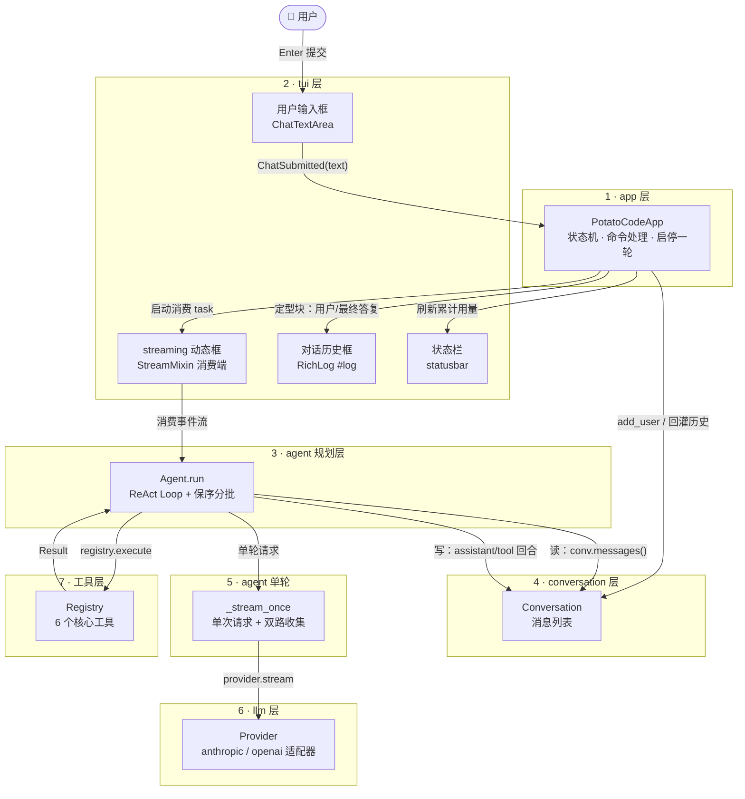
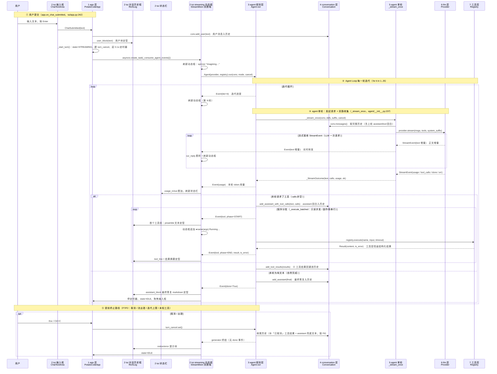

# PotatoCode 架构：七层模块与交互时序

> 用 mermaid 绘制。渲染方式任选其一：GitHub 预览 / VS Code 装 `Markdown Preview Mermaid` 插件 / Typora / Obsidian。
>
> 两张图：
> 1. **七层模块架构图** —— 层与层之间的依赖/数据流向
> 2. **交互时序图** —— 从「用户输入」到「agent 处理完成」的过程中，各层之间每一次信息交互的时机与内容

---

## 一、七层模块划分

| 层 | 模块 | 关键文件 | 关键接口 |
|---|---|---|---|
| 1 | **app 层** | `cli.py`、`tui/app.py` | `PotatoCodeApp.on_chat_submitted` / `_start_turn` / `action_cancel_or_quit` |
| 2 | **tui 层** | `tui/app.py`、`tui/stream.py`、`tui/view.py`、`tui/select.py` | 用户输入框 `ChatTextArea`、streaming 动态框 `StreamMixin._consume_agent_events`、对话历史框 `RichLog #log`、状态栏 `statusbar` |
| 3 | **agent 规划层** | `agent/__init__.py` | `Agent.run`（ReAct Loop）/ `_execute_batched`（保序分批） |
| 4 | **conversation 层** | `conversation.py` | `add_user` / `add_assistant_with_tool_calls` / `add_tool_results` / `messages` |
| 5 | **agent 单轮** | `agent/__init__.py` | `_stream_once`（一次请求 + 双路收集） |
| 6 | **llm 层** | `llm/__init__.py`、`llm/anthropic_provider.py`、`llm/openai_provider.py` | `Provider.stream(msgs, tools, system_suffix) → AsyncIterator[StreamEvent]` |
| 7 | **工具层** | `tool/__init__.py`、`tool/*.py` | `Registry.execute(name, input, timeout) → Result` |

分层约定：**上层依赖下层、单向调用**。agent 规划层只依赖 `llm / tool / conversation / prompt`，不 import 任何厂商 SDK（协议无关）；llm 层对外吐统一的 `StreamEvent`；工具层永远以值类型 `Result` 返回、绝不向调用方抛异常。

### 七层架构图

---

## 二、交互时序图（用户输入 → agent 处理完成）

参与者（左侧为 UI，右侧为远端）：

---

## 三、关键交互要点

- **两条消息通道并行**：每轮请求的流式响应走「双路」——文本增量实时经 `Event(text)` 推给 streaming 动态框（界面即时显示）；完整文本 + 拼齐 JSON 的工具调用累积在 `_stream_once` 内，供循环判断下一步（`_stream_once`，`agent/__init__.py:237`）。
- **界面三块分工**：`#streaming` 动态框只放「流式中回复 + 执行中工具指示 + 迭代进度」，可实时重绘；`RichLog #log` 对话历史框放所有已定型内容（用户块 / preamble / 工具行 / 结果摘要 / 最终答复 / 提示），可滚动回看；两者由 agent 事件流驱动，互不感知。
- **conversation 是 Agent 与 LLM 之间的「持久内存」**：每轮 `_stream_once` 从 `conv.messages()` 读完整历史；agent 每轮结束后写回 `assistant（含工具调用）` 与 `tool` 回合（`add_tool_results`），下一轮请求自动携带——这就是多轮自动连环的关键。
- **工具结果恒为结构化值**：`Registry.execute` 把未知工具 / 超时 / 异常一律包成 `Result(is_error=True)` 返回，agent 原样回灌给模型，模型据此调整或收手，从不抛异常打断循环（`tool/__init__.py:122`）。
- **事件流解耦**：agent 规划层对外只吐统一 `Event`（文本 / 工具 / 用量 / 迭代 / 提示 / done / err），tui 只消费事件、不感知循环内部细节；取消通过共享的 `asyncio.Event`（`turn_cancel`）从 app 层注入，agent 在下次迭代/await 点响应。
- **启动路径（时序图未展开）**：`cli.main` 加载配置 → `new_default_registry()` 注册 6 工具 → `PotatoCodeApp.run()`；单 provider 直进对话，多 provider 先进选择界面（`tui/select.py`）。
- **命令分支**：`/plan` 切换 `Mode.PLAN`（只注入只读工具定义 + 计划态 system 后缀）；`/do` 把 `EXECUTE_DIRECTIVE` 写入历史后走与普通消息完全相同的流程；`/exit` 退出。
